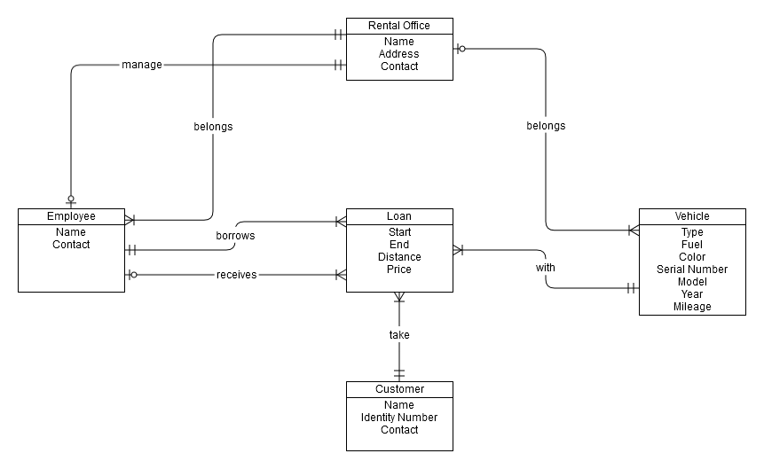
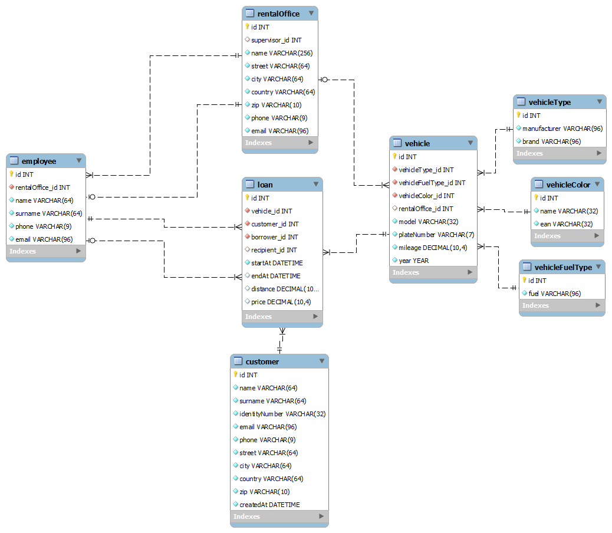

# fit-ccccar

A car-rental (autopůjčovna) web application — public vehicle catalogue with online
reservations, plus a staff back-office for handling vehicle handovers and returns.
Built in 2014 as a university course project.

## About

**CCC Car** is a small e-shop-style application for a fictional vehicle-rental
company with seven branches. Customers browse a filterable catalogue of cars,
register an account, and reserve a vehicle for a date range at a chosen branch.
Employees log into a separate admin section where they confirm the handover of a
reserved car, later close the loan (recording distance driven and return branch),
and the system computes the price from a per-day rate, a per-kilometre rate and a
late-return penalty.

It was written for a database-focused course at the Brno University of Technology,
Faculty of Information Technology (the schema, ER diagram and example SQL queries
under `sql/` were part of the assignment). It runs on a small hand-rolled
MVC-style framework and the old `mysql_*` PHP extension, so it is very much a
period piece — see **Status** and **Security notes** below.

## Features

**Public site** (`www/`)

- Vehicle catalogue with filtering (branch, fuel type, colour, price-per-day
  range, price-per-km range) plus sorting and pagination
- Vehicle detail page with a reservation form (date range + pickup branch)
- Customer registration, login/logout, profile editing and password change
- "My loans" page: list of the customer's reservations with pagination and the
  ability to cancel a reservation that has not yet been handed over
- Static pages: branch list (with staff per branch), terms, FAQ, contacts

**Admin back-office** (`www/admin/`, employees only)

- Employee login/logout and profile editing
- Loan management: filterable, paginated list of all loans
- Loan lifecycle on the loan detail page — *new* → *open* (confirm handover:
  records the issuing employee and start date) → *closed* (record distance and
  return branch; price and vehicle mileage/location are updated in a DB
  transaction) — plus cancellation
- Customer list and vehicle management

## Tech stack

- **PHP 5.x** — uses the `mysql_*` extension, removed in PHP 7
- **MySQL** — InnoDB tables with foreign keys, `utf8_czech_ci`
- No third-party framework. Hand-written pieces include:
  - a front controller with `?c=<controller>&a=<action>&s=<signal>` routing and
    `Module` path segments
  - a class autoloader, a `CC_Database` wrapper, a `CC_ModelLoader` identity map,
    entity / entity-list base classes, and a paginator
  - `.phtml` view templates
- **Front-end:** Bootstrap 3, Font Awesome, jQuery 1.11 (jQuery from a CDN, the
  rest vendored under `www/css` and `www/js`)
- **Dev tooling:** `www/tools/genEntity.php` and `genTables.php` generate entity
  classes and table constants from a live database schema

## Repository layout

```
app/
  config.php          system + database configuration
  bootstrap.php        request setup, DB connection, session, routing
  controller/          public controllers + AdminModule/ for the back-office
  model/               CC_* entities and *List collections, CC_ModelLoader
  utils/               CC_Database, CC_Utils (links/redirects/session), CC_Paginator, helpers
  view/                .phtml templates (AdminModule/ mirrors the admin controllers)
www/
  index.php            public front controller
  admin/index.php      admin front controller (redirects to login unless an employee session exists)
  css/ js/ fonts/ img/ static assets
  tools/               schema-driven code generators (dev only)
sql/
  create.sql           schema only
  insert.sql           seed data only (run after create.sql)
  create-insert.sql    schema + seed + fix-up UPDATEs in one file (recommended)
  select.sql           example analytical queries with expected output
  user.sql             CREATE USER / GRANT statements
  ccccar_db.png        schema diagram
  ccccar_erd.png       ER diagram
```

## Installation / usage

Requires a legacy environment: **PHP 5.x with the `mysql` extension** and
**MySQL 5.x**. It will not run on PHP 7+ unmodified.

1. **Database**

   ```sql
   -- create a database and user (adjust the password)
   CREATE DATABASE ccccar CHARACTER SET utf8 COLLATE utf8_czech_ci;
   CREATE USER 'ccccar'@'localhost' IDENTIFIED BY 'YOUR_PASSWORD_HERE';
   GRANT ALL PRIVILEGES ON ccccar.* TO 'ccccar'@'localhost';
   ```

   Then load the schema and seed data:

   ```bash
   mysql -u ccccar -p ccccar < sql/create-insert.sql
   ```

2. **Configuration** — edit `app/config.php`:

   - `CC_DATABASE_*` — host, database name, user and password
   - `$_SERVER["DOCUMENT_ROOT"]` is hard-coded near the top of the file; set it to
     the absolute path of the `www/` directory on your machine
   - `CC_PATH_ROOT` / `CC_PATH_ADMIN` assume the app is served from
     `http://<host>/program/www` — change the `/program/www` prefix to match how
     you host it
   - set `CC_DEVEL_MODE` to `true` for local development (enables `dump()` output)

3. **Web server** — point a PHP-capable web server at the `www/` directory.
   The public site is `www/index.php`; the admin is `www/admin/index.php`.

### Demo accounts

All seed accounts use the password **`demo1234`**.

| Role     | Email                      | Password   |
|----------|----------------------------|------------|
| Customer | `bilbo.baggins@example.com`| `demo1234` |
| Employee | `frodo.baggins@ccccar.cz`  | `demo1234` |

The seed data (people, addresses, phone numbers) is entirely fictional —
customers are named after *The Lord of the Rings* characters.

## Database reference

Nine tables. `loan` is the central entity, linking a `customer`, a `vehicle`, the
`rentalOffice` where the car is picked up, and the employees who issue
(`borrower_id`) and receive (`recipient_id`) it. A `vehicle` is described by
lookup tables for type, fuel and colour, and belongs to at most one branch.





Key columns:

| Table             | Notable columns |
|-------------------|-----------------|
| `rentalOffice`    | `name`, address fields, `phone`, `email`, `lat`/`lon`, `supervisor_id` → `employee` |
| `employee`        | `rentalOffice_id`, `name`, `surname`, `phone`, `email`, `password` (SHA-256 hex) |
| `customer`        | `name`, `surname`, `identityNumber`, `email`, `phone`, address fields, `password`, `createdAt` |
| `vehicle`         | `vehicleType_id`, `vehicleFuelType_id`, `vehicleColor_id`, `rentalOffice_id`, `model`, `plateNumber`, `mileage`, `year`, `costPerDay`, `costPerUnit` |
| `vehicleType`     | `manufacturer`, `brand` |
| `vehicleColor`    | `name`, `ean` |
| `vehicleFuelType` | `fuel` |
| `loan`            | `vehicle_id`, `rentalOffice_id`, `customer_id`, `borrower_id`, `recipient_id`, `reservedAt`, `reservedFrom`, `reservedTo`, `startAt`, `endAt`, `distance`, `price`, `deleted` |

A loan's state is derived from its timestamps: only `reserved*` set → *new*;
`startAt` set → *open*; `endAt` set → *closed*; `deleted = 1` → *cancelled*.

Example — reserve, hand over and close a loan:

```sql
-- 1. customer reserves vehicle 5 at branch 2 for a week
INSERT INTO loan (vehicle_id, rentalOffice_id, customer_id, reservedAt, reservedFrom, reservedTo)
VALUES (5, 2, 1, NOW(), '2014-06-02', '2014-06-09');

-- 2. employee 3 hands the car over
UPDATE loan SET borrower_id = 3, startAt = NOW() WHERE id = LAST_INSERT_ID();

-- 3. employee 4 takes it back after 812 km; price is computed by the app
UPDATE loan SET recipient_id = 4, endAt = NOW(), distance = 812.0, price = 9450.00
WHERE id = <loan id>;
```

See `sql/select.sql` for larger example queries (branch inventory, most active
customer, a customer × vehicle pivot of loan counts).

## Status

**Archived.** Built in 2014 as a university course project and not maintained
since. It is published for reference and as a portfolio piece. It targets a PHP 5
/ `mysql_*` stack that is long end-of-life, and it is not intended to be deployed.

## Security notes

This code does **not** follow modern practices and should not be used as a
template or run on a public server. Known issues include:

- **SQL injection** throughout — user input (including the login form) is
  concatenated directly into queries via the removed `mysql_*` API with no
  escaping or prepared statements
- **No output escaping** in templates → cross-site scripting
- **No CSRF protection** on any form
- Passwords hashed with **unsalted, single-pass SHA-256**
- `display_errors` is on and `dump()` prints session/user objects in the request
  path
- The generators in `www/tools/` are unauthenticated and connect to the database;
  they must not be reachable in any hosted setup
- The front controller builds an include path from the `c` query parameter

The database credentials in `app/config.php`, `sql/user.sql` and `www/tools/*` are
placeholders (`xxx`); set real ones locally and keep them out of version control.

## License

[MIT](LICENSE)
