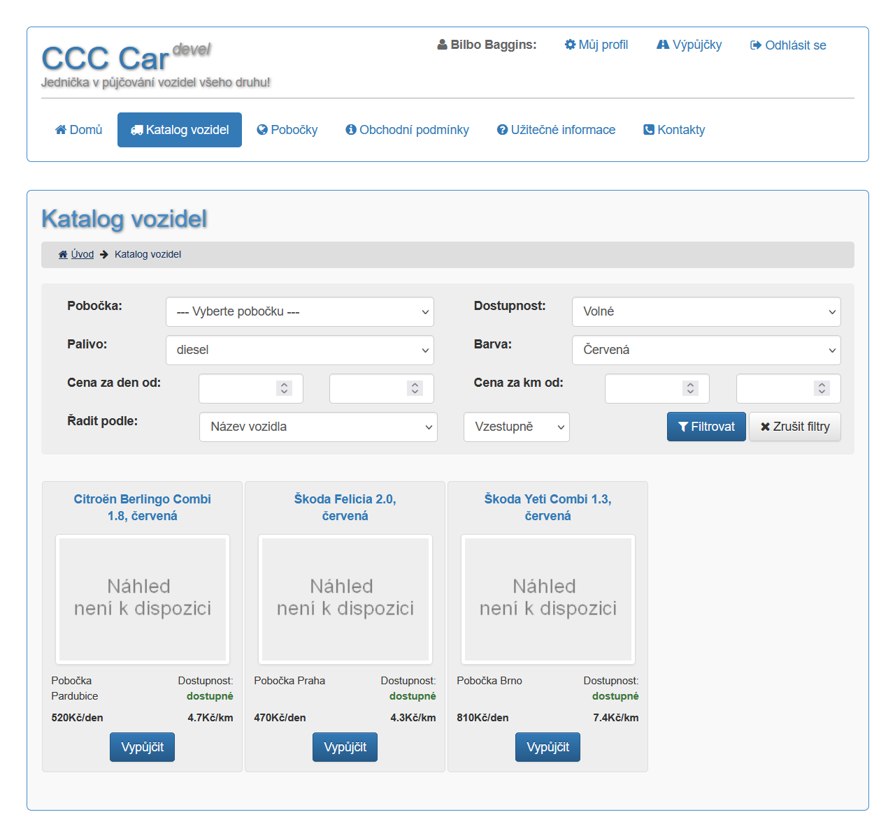
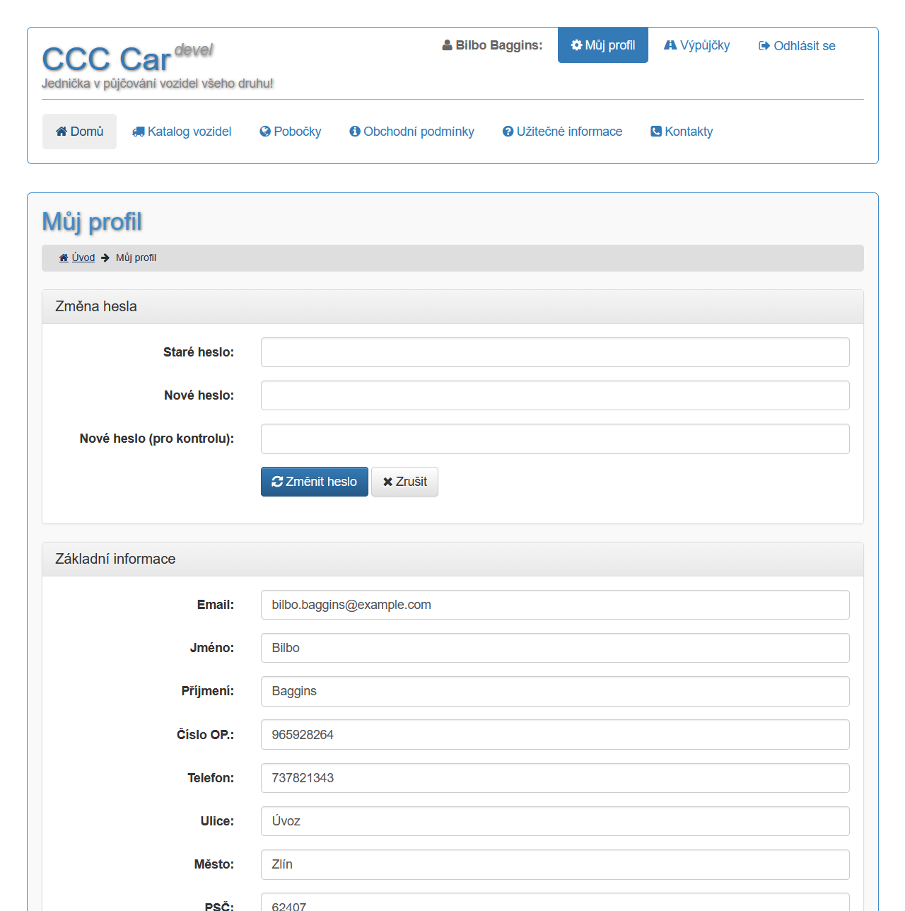
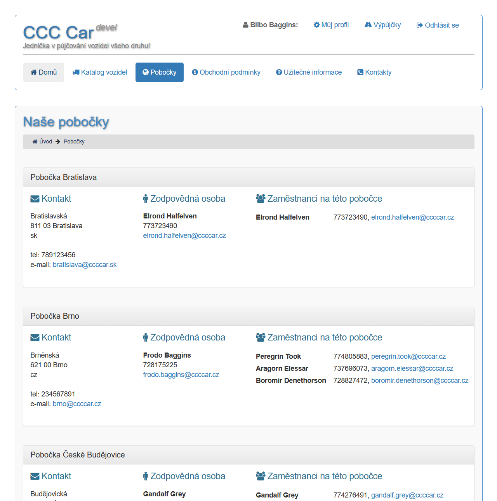
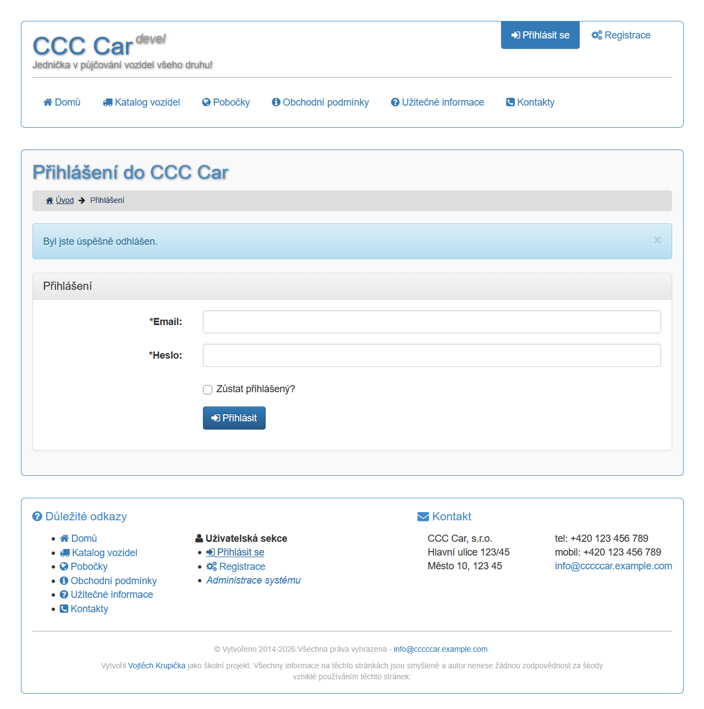
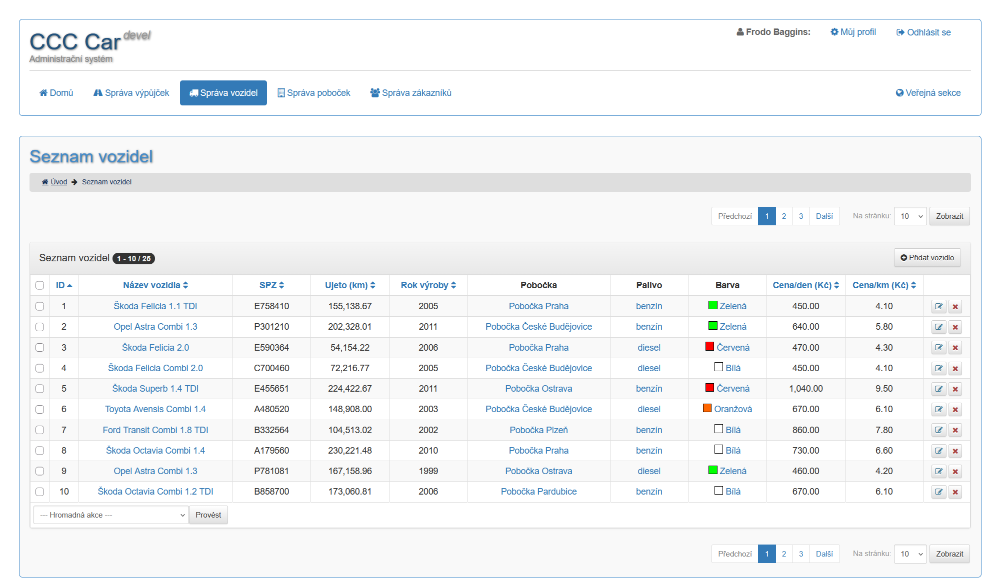
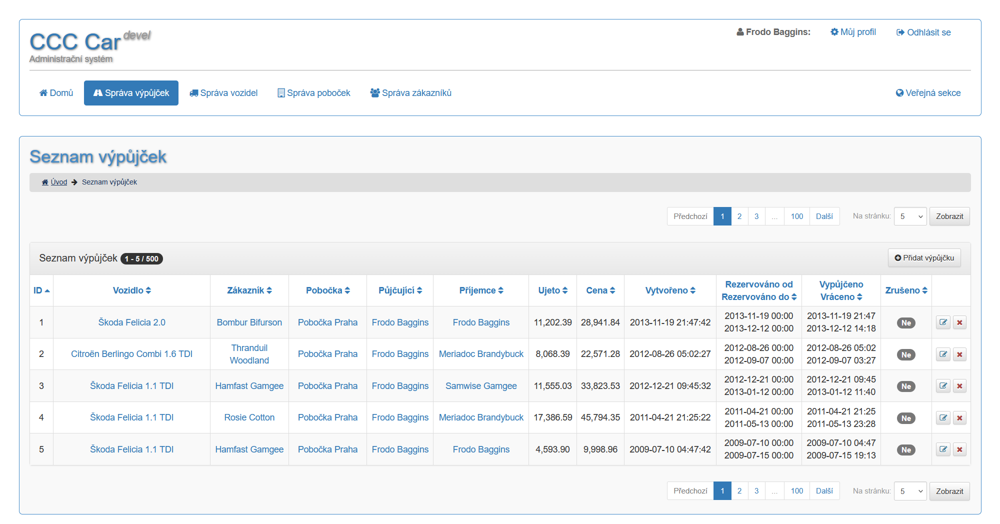

# CCC Car

A small web application for a fictional car rental company, rewritten from a legacy PHP project
(2014) to **Nette 3.3 on PHP 8.4**. Customers browse a catalog of vehicles and reserve them online;
employees manage vehicles, rental offices, customers and rentals in an administration.

It is a **learning project**. All companies, people and data are made up, and some administration
functions are still placeholders (see [Known limitations](#known-limitations)). It is not meant to be
run in production as it is.

> The user interface is in Czech. The code, comments and this documentation are in English.

## Screenshots

| Vehicle catalog (public) | Customer profile (public) |
|---|---|
|  |  |

| Rental offices (public) | Sign in (public) |
|---|---|
|  |  |

| Vehicles (administration) | Rentals (administration) |
|---|---|
|  |  |

## Features

**Public part** (`/`)

- Home page, rental offices (with their employees and supervisor), terms and conditions, FAQ, contact.
- Vehicle catalog with a filter (rental office, fuel, color, price per day and per kilometer),
  sorting and paging; vehicle detail with the list of active reservations.
- Customer accounts: registration (strong password rules), sign in (optionally "stay signed in"),
  sign out, profile editing, password change, and the list of the customer's own rentals.
- Reservation of a vehicle by a signed-in customer.

**Administration** (`/admin`)

- Separate employee sign in and session.
- Lists of rentals, vehicles, rental offices and customers, built on one reusable datagrid component:
  sortable columns, paging, page size, links to related records, row actions and bulk actions.
- Employee profile (personal data, rental office, password change) and a help page.

## Demo accounts

The mock data comes from the migrations. Never use these passwords anywhere else.

| Where | Login | Password |
|---|---|---|
| Public part (`/prihlaseni`) | `bilbo.baggins@example.com` (any customer in the mock data) | `xxx` |
| Administration (`/admin`) | `frodo.baggins@ccccar.cz` (any employee in the mock data) | `aaa` |

The mock data has 7 rental offices, 15 employees, 30 customers, 25 vehicles and 500 rentals.

## Tech stack

- **Backend:** PHP 8.4 (requires 8.2+), Nette 3.3 (Application, Forms, Database, Security), Latte 3
- **Database:** MySQL 8.4 through Nette Database Explorer; the schema and mock data are SQL files in
  `db/migrations/`
- **Front end:** Bootstrap 3.4, jQuery 3.7, Font Awesome 3.2 and Naja, all served from `www/assets`
- **Quality:** PHPUnit 13 against a real test database, PHPStan level 8, a PSR-4 check
- **Environment:** Docker Compose and a VS Code Dev Container (PHP 8.4 with Apache, MySQL 8.4,
  Xdebug). PHP and MySQL are not needed on the host.

## Getting started

Open the folder in VS Code and run **Dev Containers: Reopen in Container**, after creating the two
local configuration files:

```bash
cp .env.example .env
cp config/local.example.neon config/local.dev.neon
```

`.env` holds the database name, user, password and `WEB_PORT` (8080 by default; change it if the port
is taken). Without VS Code, start the containers yourself:

```bash
docker compose up -d
docker compose exec -u dev web bash
```

Then, inside the container as the `dev` user:

```bash
composer install
db/migrate
composer run check && composer run test
```

Open `http://localhost:<WEB_PORT>` for the public part and `http://localhost:<WEB_PORT>/admin` for the
administration.

## Commands

Run them inside the container, as the `dev` user (not as root: the files they create in `temp/` and
`log/` would become unwritable).

| Command | What it does |
|---|---|
| `composer run test` | Run the PHPUnit suite |
| `composer run phpstan` | Static analysis, level 8, on `app/` and `tests/` |
| `composer run psr` | Every class matches its file path (PSR-4), no duplicates |
| `composer run check` | `psr` and `phpstan` |
| `composer run test:db` | Drop and recreate the test database from the migrations |
| `db/migrate` | Apply pending migrations to the development database |
| `db/reset [-y]` | Drop all tables in the development database and re-run all migrations |
| `db/dump [file]`, `db/restore <file>` | Dump / restore the development database |

VS Code tasks with the same names are in `.vscode/tasks.json`.

## Configuration

| File | In git | Used when |
|---|---|---|
| `config/common.neon`, `services.neon` | yes | always |
| `config/local.example.neon` | yes | template, not loaded |
| `config/local.dev.neon` | no | `APP_ENV=dev` (the dev container) |
| `config/local.test.neon` | yes | `APP_ENV=test` (PHPUnit); the throwaway test database |
| `config/local.prod.neon` | no | `APP_ENV=prod` (the default when the variable is unset) |

`Bootstrap` stops with a clear error when the file for the current `APP_ENV` is missing. `NETTE_DEBUG=1`
turns on debug mode (Tracy) independently of `APP_ENV`; it must stay off in production. Production
without environment variables (shared hosting) uses literal values in `local.prod.neon`.

## Database

The schema (`0001_create_schema.sql`) and the mock data (`0002_populate_tables.sql`) are numbered
migrations; `db/migrate` records the applied ones in a `schema_migrations` table. Tables use
`snake_case` names, `utf8mb4`, and foreign keys with `RESTRICT` where deleting would lose history.
`customer.email` and `employee.email` are unique, because the e-mail is the login name.

New schema or data changes go into a **new** numbered migration. Before the first release the two
existing migrations were still edited, and the development database was rebuilt with `db/reset`.

## Architecture

```
app/
├── Bootstrap.php          debug mode and configuration loading
├── Core/                  router (Czech URLs), authenticators, the PostSideEffect attribute
├── Model/                 business and persistence layer, one folder per entity
└── UI/                    presenters and templates, one folder per module
    ├── Front/             public part (presenters + its own components and forms)
    ├── Admin/             administration (presenters + its own components and forms)
    ├── Error/             4xx and 5xx error pages
    └── Shared/            components used by both parts: datagrid, pagination, menus, forms
```

**Model.** Every entity follows the same chain, and presenters talk only to the last link:

`Entity` (plain data, public properties) ← `DbMapper` (row ⇄ entity, knows the table name) ←
`Repository` (queries) ← `Facade` (use cases, for example `changePassword`)

The generic base classes (`BaseMapper`, `BaseRepository`, `BaseFacade`) hold the common CRUD and are
typed with PHPDoc templates, so PHPStan knows the entity type everywhere. Searches take a small
immutable object per entity (`VehicleFilter` with a `VehicleSortBy` and a `SortDirection`) and a shared
`PageRequest`, and return an `EntityList` with the paging information. Sort options are enums mapped
to fixed SQL, so request values never reach `ORDER BY`.

**UI.** Pages are presenters grouped in the `Front` and `Admin` modules; the two modules keep their
logins apart (separate session namespaces and separate authenticators). Reusable parts are
components with their own factories. The datagrid is built from columns, formatters (link, e-mail,
color) and actions, and renders in Latte, so all values are escaped.

**Security notes.** Passwords are stored only as bcrypt hashes and the password rules are enforced on
registration and change. Every state-changing action (delete, sign out) accepts only a same-origin
POST (`#[PostSideEffect]`); forms and signals are same-origin by default in Nette 3.3. Output is
escaped by Latte, and SQL uses placeholders or enum-built fragments only.

## Tests

The suite has more than 240 tests and runs in a few seconds. Tests use the database
`<MYSQL_DATABASE>_test`, built from the same migrations (`composer run test:db`), and refuse to run
against any other database. Each test runs in a rolled-back transaction with a fresh DI container.

- `Tests\DatabaseTestCase`: the database and the container.
- `Tests\PresenterTestCase`: `runPresenter()`, `submitForm()`, `signal()`, `renderPage()`, and
  `loginAs()` for signed-in users (an in-memory login, no PHP session).
- Repositories, mappers and facades are tested against the mock data; presenters and forms are tested
  end to end (sign in and up, profiles, catalog filter, reservations, datagrid, access control).

After changing the mock data in a migration, rebuild the test database. The container has Xdebug on;
the composer script switches it off for tests. Coverage: `XDEBUG_MODE=coverage vendor/bin/phpunit
--coverage-text`.

## Known limitations

- **Add, edit and delete** in the administration lists only show a notice that the function is not
  implemented, and the **bulk actions** only report which records they would change. Nothing is
  modified or deleted.
- **Availability** is not computed: the catalog's availability filter has no effect and every vehicle
  is shown as available. A reservation is not checked against existing reservations (overlaps) or for
  sensible dates.
- **The data model** is carried over from the 2014 version and has known gaps: it has no availability or
  overlap rules for reservations, and some of its constraints are looser than a production system
  would need. Fixing it properly would mean redesigning the schema, which is out of scope here.
- No password reset, e-mail sending or e-mail verification.
- Every employee has full access to the administration (there are no roles yet).
- The front end uses old libraries (Bootstrap 3, Font Awesome 3); the interface is Czech only.

## Deployment

Only `www/` may be web-accessible. For Docker, mount or bake in `config/local.prod.neon` and leave
`APP_ENV` and `NETTE_DEBUG` unset. For FTP hosting use `config/deployment.example.ini`: copy it to
`config/deployment.ini` (git-ignored), deploy from a clean `git archive` export with
`composer install --no-dev --optimize-autoloader`, preview with `-t`, and apply new migrations by
hand. Never apply the mock-data migration (`0002`) in production.

## Project layout

```
app/                      Bootstrap, Core, Model, UI (see Architecture)
config/                   common.neon, services.neon, local.*.neon, deployment.example.ini
db/                       migrations/, dumps/ (git-ignored), scripts migrate, reset, dump, restore, test-reset
docker/                   PHP/Apache image, MySQL init script
docs/                     screenshots used in this README
tests/                    bootstrap, DatabaseTestCase, PresenterTestCase, and the tests
www/                      public document root (index.php, assets/, resources/ for uploads)
log/ temp/                runtime directories (contents git-ignored)
```

## Background

The project started in 2014 as a school project in legacy PHP. This version keeps the data model
and the idea, and rebuilds the application on a current stack. It started from a Nette 3.3 project
skeleton with the Docker environment, migrations and test tooling.

## Licence

MIT, see `LICENSE`.
